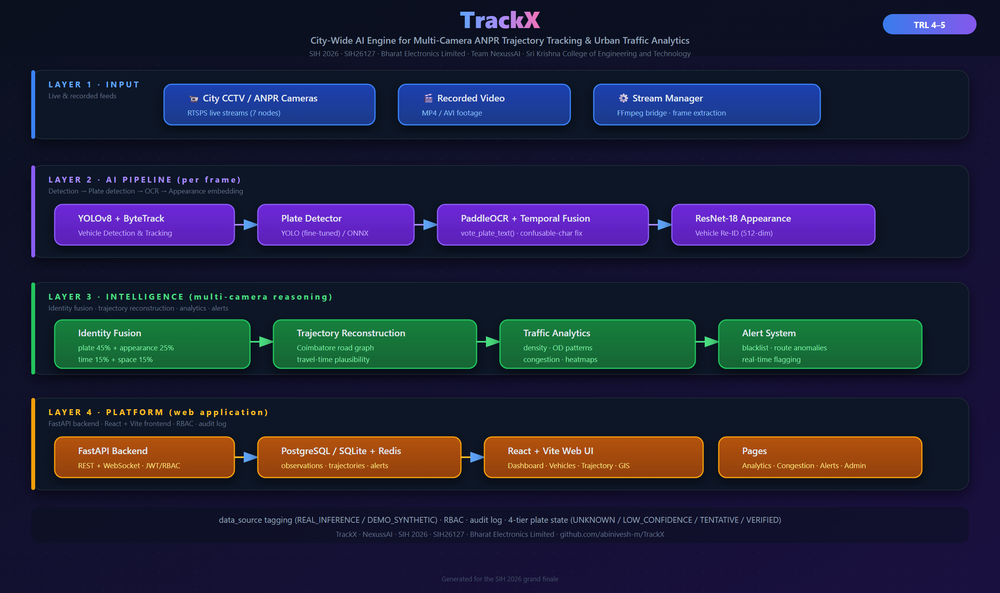

# TrackX — City-Wide AI Engine for Multi-Camera ANPR Trajectory Tracking

<p align="center">
  
  
  
  
</p>

<p align="center">
  <a href="https://github.com/abinivesh-m/TrackX/actions/workflows/test.yml"></a>
  <a href="https://github.com/abinivesh-m/TrackX/actions/workflows/security.yml"></a>
  
  
  
  
</p>

> **Turn a city's existing CCTV/ANPR network into a unified vehicle-intelligence platform — no new hardware required.**

TrackX is a centralized, enterprise-grade software platform that fuses **plate text + vehicle appearance + time + location** across geographically distributed cameras to reconstruct a single vehicle's complete journey on a GIS map, while computing city-wide traffic density, origin–destination patterns, congestion bottlenecks and real-time heatmaps, and flagging blacklisted vehicles and suspicious route anomalies in real time.

| | |
|---|---|
| 🌐 **Live demo** | https://trackx-scoj.onrender.com |
| 🎬 **Demo video** | https://youtu.be/nd0tCe5RH-8 |
| 📁 **Drive (datasets / models)** | https://drive.google.com/drive/folders/1Z6f89znJKj9f1LXG2pi7tEtfIhIcJ57A |
| 🏫 **Institute** | Sri Krishna College of Engineering and Technology |
| 👥 **Team** | NexussAI (ID 178670) · 6 members · 2 mentors |

---

## ✨ Why TrackX

Most city ANPR systems process cameras in **isolated silos** — they detect a plate, store a row, and stop. TrackX is built around the insight that the *value* is in **linking** observations across space and time:

- 🔗 **Cross-camera identity fusion** — a 4-signal score (plate 45% · appearance 25% · time 15% · space 15%) with impossible-speed transitions explicitly rejected.
- 🧠 **Three-stage OCR temporal fusion** — whole-string voting → confidence-weighted confusable-character correction (0/O, 1/I, 8/B, D/O, …) → fragment clustering. Turns 12 noisy reads of one plate into one best guess with a confidence + reading count.
- 🛡️ **Honest, ANDed confidence tiers** — `VERIFIED` requires **both** ≥3 readings **and** ≥70% confidence. Low-confidence reads are withheld, never asserted.
- 🗺️ **Real road-graph math** — per-segment distances and travel-time plausibility from a real Coimbatore road graph, not straight-line haversine.
- 🏷️ **`data_source` discipline** — every observation tagged `REAL_INFERENCE` / `DEMO_SYNTHETIC`, with UI badges. City-wide views never mix synthetic data into what is presented as real.
- 🔐 **Production-shaped auth** — JWT, PBKDF2 password hashing, audit logging, per-IP rate limiting, RBAC (admin/operator/auditor), blacklist management.

---

## 🏗️ Architecture

<!-- Replace with your Figma-exported diagram: docs/architecture.png -->
<p align="center">
  
</p>

```
City CCTV (RTSPS) / recorded video
        │
        ▼
┌────────────────────┐   ┌──────────────────┐   ┌──────────────────┐
│  YOLOv8 + ByteTrack│──▶│ Plate detector   │──▶│ PaddleOCR +      │
│  (vehicle detect & │   │ (YOLO, fine-tuned│   │ temporal fusion  │
│   track)           │   │  or ONNX)        │   │ (vote_plate_text)│
└────────────────────┘   └──────────────────┘   └────────┬─────────┘
                                                         │
        ┌────────────────────────────────────────────────┘
        ▼
┌────────────────────┐   ┌──────────────────┐   ┌──────────────────┐
│ ResNet-18 vehicle  │   │ Identity fusion  │   │ Trajectory /     │
│ appearance (Re-ID) │──▶│ 4-signal score   │──▶│ road-graph + GIS │
└────────────────────┘   └──────────────────┘   └────────┬─────────┘
                                                         │
        ┌────────────────────────────────────────────────┘
        ▼
┌──────────────────────────────────────────────────────────────────┐
│ FastAPI backend · PostgreSQL/SQLite · React + Vite web UI        │
│ Dashboard · Vehicles · Trajectory · GIS · Analytics · Congestion │
│ RouteAnomaly · Alerts · Cameras · Admin (RBAC + audit log)       │
└──────────────────────────────────────────────────────────────────┘
```

> 📌 **Diagram placeholder:** drop your Figma-exported architecture image at `docs/architecture.png` and it will render above automatically.

---

## 🧰 Tech stack

| Layer | Technologies |
|---|---|
| **AI / ML** | YOLOv8, ByteTrack, PaddleOCR 2.7, LPRNet, ResNet-18, OpenCV, NumPy, PyTorch |
| **Backend** | FastAPI, Uvicorn, SQLAlchemy, Alembic, Pydantic, JWT (PyJWT), Redis, PostgreSQL/SQLite |
| **Frontend** | React 18, TypeScript, Vite, TailwindCSS, Leaflet, Recharts, Axios |
| **Intelligence** | NetworkX (road graph), GeoPy, Folium, scikit-learn |
| **Infra** | Docker, Docker Compose, Render, Railway, GitHub Actions |
| **Testing** | unittest (155 tests), pytest, Bandit, Safety |

---

## 📁 Project structure

```
TrackX/
├── backend/          FastAPI app (auth, cameras, vehicles, analytics, alerts, …)
├── frontend/         React + TypeScript + Vite web UI
├── detection/        YOLO plate + vehicle detection, training, validation
├── recognition/      OCR (PaddleOCR), LPRNet, normalizer, appearance (Re-ID)
├── network/          Camera topology + Coimbatore road graph
├── intelligence/     Fusion, trajectory, anomaly scoring, alerts, route hypothesis
├── database/         SQLite/Postgres stores (observation, alert, blacklist, …)
├── analytics/        Traffic density, OD patterns, congestion model
├── gis/              Folium interactive map generation
├── demo/             Offline/video demo flows, seeding, visual pipeline
├── tests/            Unit tests (155 passing)
├── backend/tests/    API + integration tests
├── docs/             Audits, accuracy reports, tuning notes, playbook
├── models/           Model weights (best.onnx shipped; .pt via release assets)
└── pipeline.py       CLI entry point (detect → OCR → fuse → DB)
```

---

## 🚀 Quick start

### Prerequisites
- Python 3.11, Node.js 18+, (optional) Docker

### Backend (FastAPI)
```bash
cd backend
pip install -r requirements.txt
uvicorn app.main:app --reload --port 8000
# API docs → http://localhost:8000/docs
# Dev login → admin@trackx.com / admin123  (change for anything beyond a local demo)
```

### Frontend (React)
```bash
cd frontend
npm install
npm run dev
# Opens http://localhost:5173
```

### CLI pipeline (offline video)
```bash
python pipeline.py --video data/sample.mp4 --plate_weights models/best.onnx \
  --camera_id CAM_01 --lat 11.0 --long 77.0
```

### Run tests
```bash
# Root suite
python -m unittest discover -s tests -p "test_*.py"

# Backend suite
cd backend && python -m pytest tests/ -q
```

---

## 🎯 SIH26127 requirement coverage

| Requirement (from PS) | TrackX implementation |
|---|---|
| High-accuracy ANPR/OCR (>90% target) | PaddleOCR + multi-frame temporal fusion + adaptive preprocessing + confidence tiers (measured & audited — see `docs/OCR_REAL_ACCURACY_AUDIT.md`) |
| Single-plate trajectory tracking | `intelligence/trajectory.py` + `intelligence/fusion.py` (4-signal) on Coimbatore road graph |
| Macro traffic flow analytics | `analytics/analytics.py` — density, OD patterns, congestion, heatmaps |
| GIS-integrated dashboard | React + FastAPI + Folium/Leaflet maps |
| Real-time alert system | Blacklist + route-anomaly + repeated-camera detection, persisted |

---

## 🗺️ Roadmap (productionization)

TrackX is a working prototype (TRL 4–5). The following are scoped, known next steps:

- **OCR → >90%**: retrain on ANPR-resolution Indian plates + per-vehicle multi-frame voting.
- **Horizontal scalability**: job queue for concurrent camera processing, Postgres/PostGIS in production, horizontal workers.
- **Camera onboarding**: ONVIF-style discovery instead of the current hardcoded camera dict.
- **Secrets at rest**: encrypt the RTSP credentials (currently in `.env`).
- **RTSPS auto-reconnect** on a camera drop.
- **Wire `route_hypothesis.py`** into a live endpoint (code exists, not yet exposed).
- **Learned `CAMERA_RELIABILITY`** weights from real match outcomes instead of hand-tuning.

---

## 🔐 Security & data integrity

- `data_source` tagging (`REAL_INFERENCE` / `DEMO_SYNTHETIC`) across DB and read endpoints, with UI badges.
- JWT auth, PBKDF2 password hashing, audit logging, per-IP rate limiting, RBAC.
- `.env` is gitignored; only `.env.example` is committed.
- No model weights (`.pt`) or databases (`.db`) are committed; `models/best.onnx` is the one shipped artifact so plate detection works out of the box.

---

## 📜 License

MIT — see [LICENSE](LICENSE).

---

## 👥 Team

**NexussAI** · Abinivesh M (lead) · Boobana D · Abishek M · Abhinivesh K · Nitin Kumar R · Sri Shylesh S
Mentors: M. Kalimuthu, S. Shanmuga Raju · Sri Krishna College of Engineering and Technology.

---

<p align="center">
  <sub>Built with ❤️ for Smart India Hackathon 2026 · Problem Statement SIH26127 · Bharat Electronics Limited</sub>
</p>